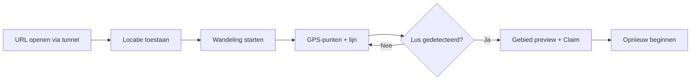

# Plan — GPS Territory Claiming (INTVL-achtig)

## 1. Doel

Een **statische website** (HTML, CSS, JavaScript) waarmee je op je **gsm** een wandeling start, je **live GPS-traject** op een kaart ziet, en wanneer je een **gesloten lus** maakt, het **omsloten gebied automatisch** wordt herkend en **visueel geclaimd** op de kaart.

**Eerste versie:** werkende demo op één apparaat, geen accounts, geen serverlogica, geen multiplayer.

**Referentie:** gedrag vergelijkbaar met [INTVL](https://intvl.app/) — territorium door een fysieke ronde te lopen — maar bewust minimaler.

---

## 2. Vaste keuzes

| Onderdeel | Keuze |
|-----------|--------|
| Frontend | HTML, CSS, vanilla JS (geen framework) |
| Kaart | [Leaflet](https://leafletjs.com/) + OpenStreetMap-tegels |
| Locatie | Browser Geolocation API (`watchPosition`) |
| Backend | Geen — alles in de browser (geheugen; later optioneel `localStorage`) |
| Lokaal hosten & gsm | **Cloudflare Tunnel** (`cloudflared`) of **Wrangler Pages dev** — site bereikbaar via **HTTPS-URL** op je telefoon (geolocatie vereist HTTPS) |

**Waarom Cloudflare op je PC:** je bouwt lokaal, exposeert tijdelijk via tunnel/dev-server, opent de link op je gsm en test de echte GPS-flow buiten.

---

## 3. MVP — must-have

- [ ] Toestemming voor locatie; duidelijke status (signaal, nauwkeurigheid, tracking aan/uit).
- [ ] Kaart met huidige positie (marker) en periodieke updates tijdens wandelen.
- [ ] **Wandeling starten / stoppen**; traject als polyline.
- [ ] **Automatische detectie van een gesloten lus** (niet alleen “eindpunt dicht bij start” bij stop — ook signaleren tijdens de route wanneer je de startzone opnieuw binnenkomt na voldoende afgelegde weg).
- [ ] Bij geldige lus: **polygon** over de route, semi-transparante vulling = geclaimd gebied.
- [ ] **Claim bevestigen** (expliciete knop) en **opnieuw beginnen** (route + claim wissen).
- [ ] Mobiele UI: grote knoppen, kaart dominant, korte fout-/succesmeldingen.

---

## 4. Buiten scope (v1)

Accounts, multiplayer, gedeelde database, scores/ranglijsten, alle mogelijke gesloten deelfiguren, anti-cheat, achtergrondtracking, native app, Arduino/sensoren, geavanceerde kaartoptimalisatie.

---

## 5. Gebruikersflow (gsm)



1. Op PC: project starten + tunnel/dev-URL.
2. Op gsm: URL openen, locatie inschakelen.
3. **Wandeling starten** → lopen.
4. App **detecteert zelf** wanneer de lus gesloten is (startzone + minimum route).
5. Gebruiker ziet ingekleurd gebied → **Claim gebied** → klaar of **Opnieuw beginnen**.

---

## 6. UI (één pagina)

- **Kaart** (~70–80% viewport).
- **Statusbalk:** GPS OK / wachten / geweigerd; nauwkeurigheid (m); wandeling actief ja/nee; “Lus gedetecteerd”.
- **Knoppen:** Locatie inschakelen · Wandeling start · Wandeling stop · Claim gebied · Opnieuw beginnen (states en disabled waar nodig).
- **Stats:** aantal punten, geschatte afstand (Haversine over opgeslagen punten).

---

## 7. Logica — GPS & route

- `watchPosition` met `enableHighAccuracy: true`, redelijke `maximumAge` / `timeout`.
- **Filter:** punten weglaten bij slechte `accuracy` (start: bv. > 40 m); optioneel minimum afstand tot vorig punt (bv. 3–5 m) tegen stilstaande ruis.
- Tijdens wandeling: polyline live updaten; watch stoppen bij stop/reset.

---

## 8. Logica — automatische lusdetectie

**Startzone:** cirkel rond eerste opgenomen punt (radius `R_close`, bv. 25–35 m — tuneerbaar constante in `app.js`).

**Minimum route (tegen false positives):**

- Minimaal **N punten** (bv. 20) en **minimale omloopafstand** (bv. 150–200 m) vóór een lus mag tellen.

**Detectie (doorlopend tijdens opname):**

1. Na minimum route: als huidige positie **in startzone** komt **en** het traject sinds laatste “startzone exit” voldoende lengte heeft → **lus candidate**.
2. Polygon = routepunten in volgorde; sluit met eerste punt indien nodig.
3. UI: melding “Gesloten lus gedetecteerd” + preview-vulling; **Claim** blijft handmatig.

**Bij wandeling stoppen:** zelfde check (eindpunt in startzone + minima) als fallback als detectie tijdens lopen gemist werd.

**Beperking:** GPS is ruizig; polygon kan scheef zijn — v1 is prototype, geen landmeetkunde.

---

## 9. Ontwikkel- & testomgeving

**Structuur:**

```
gps-territory/
├── index.html
├── style.css
├── app.js
├── plan.md
└── README.md
```

**Cloudflare (kies één pad voor v1):**

- **Optie A — Wrangler:** `npx wrangler pages dev .` → HTTPS URL op LAN/tunnel indien geconfigureerd.
- **Optie B — Tunnel:** statische server lokaal (bv. `npx serve .`) + `cloudflared tunnel --url http://localhost:PORT` → publieke HTTPS-link voor gsm.

**README:** stappen tunnel/dev, “open op gsm”, HTTPS/locatie-permissies, korte testchecklist.

**Test op gsm:** toestemming ja/nee, slecht signaal, te korte ronde, geldige ronde, claim + reset.

---

## 10. Implementatiestappen

| # | Stap | Klaar als |
|---|------|-----------|
| 1 | `index.html` / `style.css` / `app.js` + Leaflet + lege kaart | Kaart zichtbaar lokaal én via tunnel-URL op gsm |
| 2 | Live GPS + marker + nauwkeurigheid + foutafhandeling | Marker beweegt buiten |
| 3 | Start/stop opname, gefilterde punten, polyline | Korte wandeling = lijn |
| 4 | Startzone + min. afstand/punten + **continue lusdetectie** + fallback bij stop | Ronde terug naar start → melding + candidate |
| 5 | Polygon preview, Claim, Opnieuw beginnen | Ingekleurd gebied + reset werkt |
| 6 | Mobiele polish + README (Cloudflare + test) | End-to-end op telefoon |

**Start nu:** alleen **stap 1** — geen GPS tot de kaart op pc én gsm via HTTPS werkt.

---

## 11. Claimregels (v1)

1. Minimum punten + minimum omloopafstand.
2. Herentry in startzone na echte omloop (automatisch + fallback bij stop).
3. Routepunten = polygonrand.
4. Claim alleen na expliciete knop.
5. Geen data naar server; tracking stoppen bij stop/reset.

---

## 12. Privacy

Korte uitleg in UI waarom locatie nodig is; geen verzending van coördinaten; duidelijk “Tracking actief” tijdens wandeling.

---

## 13. Na MVP (optioneel)

`localStorage` voor claims, oppervlakte/afstand, meerdere polygons, eenvoudige GPS-gladstrijking, later backend/multiplayer.

---

## 14. Definition of done (MVP)

- [ ] Kaart via Cloudflare/tunnel-URL op gsm (HTTPS).
- [ ] GPS-permissie + live positie.
- [ ] Wandeling opnemen als lijn.
- [ ] **Automatische** lusdetectie + fallback bij stop.
- [ ] Ingekleurd gebied + claim + reset.
- [ ] Duidelijke meldingen bij geen GPS / geen geldige lus.

---

## 15. Eerste taak

**Stap 1:** drie bestanden, Leaflet, mobiel-vriendelijke layout, README met tunnel/W wrangler-commando’s. Valideer op telefoon vóór GPS-code.
